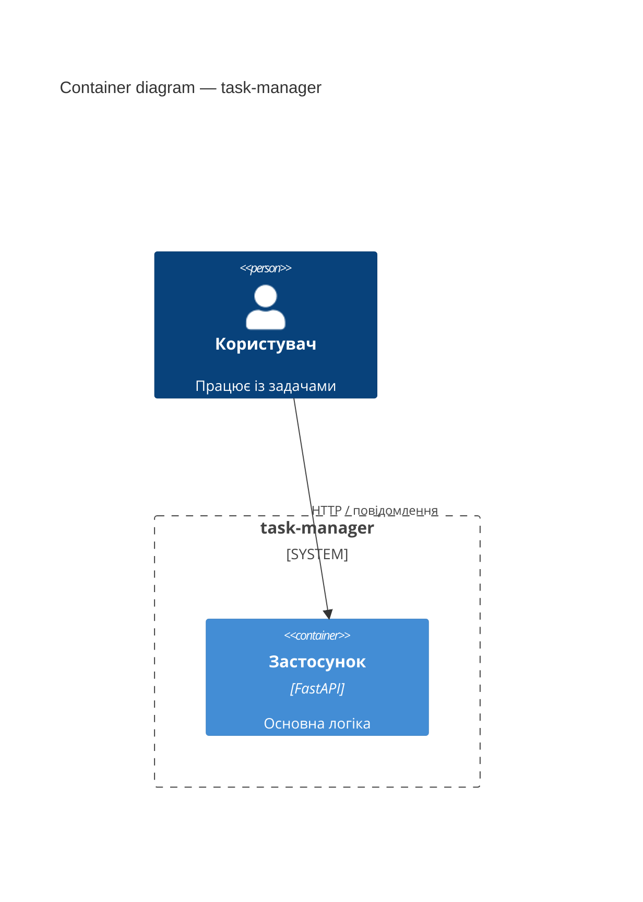
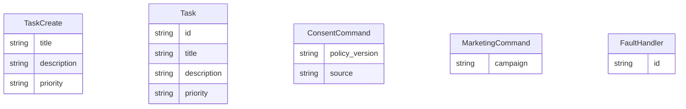

# SDD — System Design Document

> Проєкт: **task-manager**. Сформовано 2026-11-15. Мова: Python; фреймворк: FastAPI.
> Деталі розгортання кожного компонента — у [ISD](isd.md).

## 1. Архітектура (C4, рівень контейнерів)

## 2. Компоненти

| Компонент | Відповідальність | Взаємодіє з | Розгортання (ISD) |
|---|---|---|---|
| checkout | Оформлення замовлення (лабораторна 8) | — | [isd.md](isd.md#checkout) |
| config | Модуль `config` (відповідальність уточнити вручну) | — | [isd.md](isd.md#config) |
| dependency | Модуль `dependency` (відповідальність уточнити вручну) | — | [isd.md](isd.md#dependency) |
| main | Модуль `main` (відповідальність уточнити вручну) | [dependency](#dependency), [models](#models), [privacy](#privacy), [services](#services) | [isd.md](isd.md#main) |
| models | Модуль `models` (відповідальність уточнити вручну) | — | [isd.md](isd.md#models) |
| payments | Оплата замовлення через платіжний шлюз: незмінні Value Objects | — | [isd.md](isd.md#payments) |
| privacy | Модуль `privacy` (відповідальність уточнити вручну) | — | [isd.md](isd.md#privacy) |
| reporting | Експортери звітів (лабораторна 8) | — | [isd.md](isd.md#reporting) |
| services | Модуль `services` (відповідальність уточнити вручну) | [models](#models), [validators](#validators) | [isd.md](isd.md#services) |
| validators | Модуль `validators` (відповідальність уточнити вручну) | [models](#models) | [isd.md](isd.md#validators) |

### Залежності між компонентами (з імпортів)

- `main` → `dependency`
- `main` → `models`
- `main` → `privacy`
- `main` → `services`
- `services` → `models`
- `services` → `validators`
- `validators` → `models`

## 3. Модель даних

Джерела: `app/models.py`, `app/models.py`, `app/privacy/api.py`, `app/privacy/api.py`, `fault_server.py`

## 4. API-контракти

| Метод | Шлях | Компонент-власник | Файл |
|---|---|---|---|
| GET | `/tasks` | checkout | `app/main.py` |
| GET | `/tasks/{task_id}` | checkout | `app/main.py` |
| POST | `/tasks` | checkout | `app/main.py` |
| PATCH | `/tasks/{task_id}/status` | checkout | `app/main.py` |
| DELETE | `/tasks/{task_id}` | checkout | `app/main.py` |
| GET | `/dependency/raw` | checkout | `app/main.py` |
| GET | `/dependency/resilient` | checkout | `app/main.py` |
| GET | `/api/users/{user_id}/personal-data` | checkout | `app/privacy/api.py` |
| POST | `/api/users/{user_id}/anonymize` | checkout | `app/privacy/api.py` |
| POST | `/api/users/{user_id}/consents/{purpose}/grant` | checkout | `app/privacy/api.py` |
| POST | `/api/users/{user_id}/consents/{purpose}/revoke` | checkout | `app/privacy/api.py` |
| POST | `/api/marketing/send/{user_id}` | checkout | `app/privacy/api.py` |

### Контракти між компонентами

- `main` викликає публічні функції `dependency` (in-process)
- `main` викликає публічні функції `models` (in-process)
- `main` викликає публічні функції `privacy` (in-process)
- `main` викликає публічні функції `services` (in-process)
- `services` викликає публічні функції `models` (in-process)
- `services` викликає публічні функції `validators` (in-process)
- `validators` викликає публічні функції `models` (in-process)
